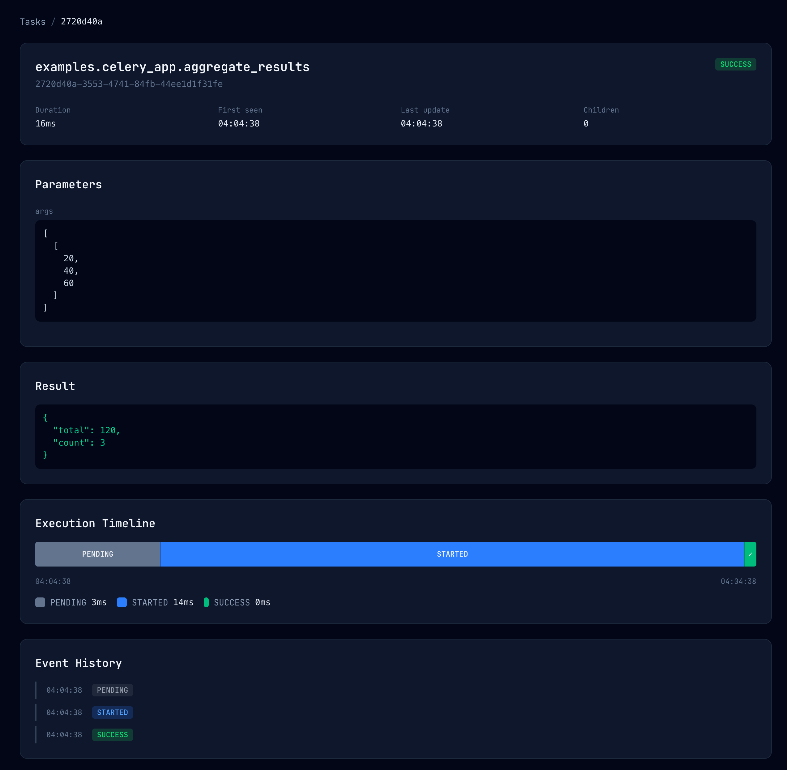
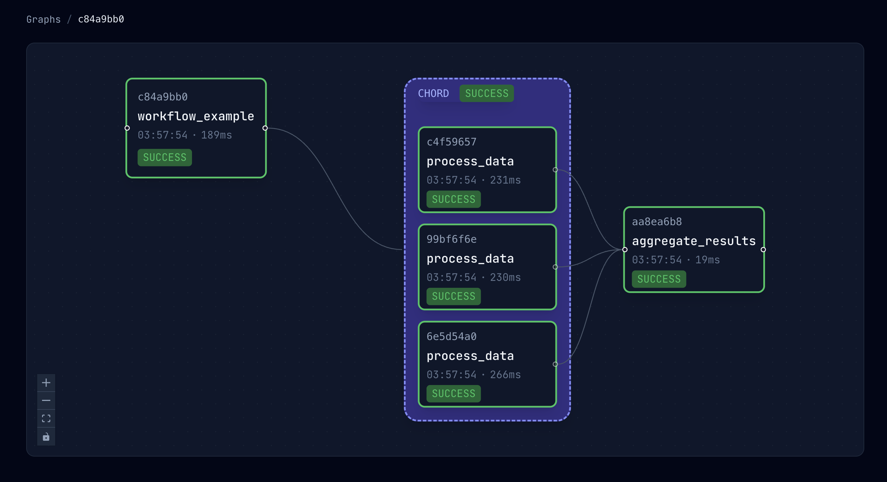
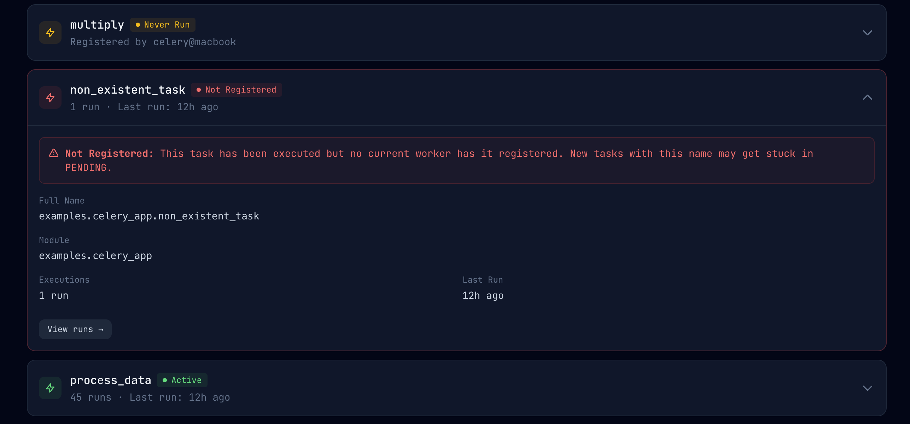

# Features

What stemtrace records about your Celery tasks, and what the dashboard shows.

## Features

**See What Happened**
- **Task Flow Graphs**: Visualize chains, groups, and chords as interactive DAGs ([Graphs](graphs.md))
- **Execution Timeline**: Track queued → started → retried → finished states
- **Full lifecycle tracking**: PENDING → STARTED → SUCCESS/FAILURE, with RECEIVED when `publish_received=True` is set on the worker ([Received events](configuration.md#received-events-opt-in))
- **Arguments & Results**: Inspect inputs, outputs, and exceptions
- **Task Output**: See what each attempt printed and logged, next to the task (opt-in, see [Task output](configuration.md#task-output-print-and-logging))
- **Retry Chains**: Understand exactly when and why retries happened
- **Queue wait and runtime**: How long each task waited before it started and how long it ran, apart from its overall duration ([details](#queue-wait-and-runtime))
- **Worker, queue and exception type**: Which worker ran each task, which queue it came from, and the exception class of failures, with API filters ([details](#worker-queue-and-exception-type))
- **Real-time updates**: WebSocket-powered live dashboard

**Canvas Support**
- **Groups & Chords**: Automatic visualization of `group()` and `chord()` patterns
- **Parent-Child Tracking**: See which task spawned which

**Worker Monitoring & Registry**
- **Workers page**: See which workers are online/offline and what tasks they have registered
- **Registry status badges**: Quickly spot tasks that are active, never run, or not registered by any current worker
- **Task groups**: Every task belongs to a group, taken from its name or from your rules, with tags; in the API for now ([Task groups](configuration.md#task-groups))

**Production Ready**
- **Zero Infrastructure**: Uses your existing broker (Redis or RabbitMQ), no database needed
- **Sensitive Data Scrubbing**: Passwords and API keys filtered automatically ([Security](security.md))
- **Read-Only**: Safe for production; never modifies your task queue
- **FastAPI Integration**: Mount into your existing app with one line ([Deployment](deployment.md#embedded-in-fastapi))

## What you'll see in the dashboard

### Task details (timing, inputs/outputs, errors)

- **What you'll see**: Per-task execution timing (including how long it spent in each state), parameters (args/kwargs), return value, and the full event history.
- **Why it helps**: Quickly answer "what happened?" for a single task: slow queueing vs slow execution, which retry succeeded, and (on failures) the exception + traceback for debugging.

  

### Flow graphs (chains, groups, chords)

- **What you'll see**: An interactive DAG of your workflow with parent→child edges, plus clear GROUP/CHORD containers for Celery canvas patterns.
- **Why it helps**: Understand fan-out/fan-in at a glance (especially chords), spot which branch failed, and debug "why didn't my callback run?" without grepping logs.

  

### Task registry (registration status + warnings)

- **What you'll see**: A registry of tasks with status badges like **Active**, **Never Run**, and **Not Registered** plus "registered by …" worker info.
- **Why it helps**: Catch misconfigurations where tasks get stuck in **PENDING** because no current worker has the task registered (common in multi-repo or deploy drift scenarios).

  

### Workers and registry tabs

stemtrace uses **Celery inspect** on demand to populate workers and registered tasks, so those
pages work even if the server missed `worker_ready` events.

- A Celery nodename (`name@host`) has at most one live process, so a worker is shown online
  only for its newest pid: when a node restarts, its older pids go offline, including one that
  was killed without a `worker_shutdown` event. A ping reply carries no pid, so it can only
  bring back the newest pid, never one that sent `worker_shutdown`. When the stream and an
  inspect reply disagree, whichever is newer wins: events that arrive while the server waits
  for a reply beat that reply.
- A worker is shown offline once 3 minutes pass without a sign of life from it: its
  `worker_ready`, an event from one of its tasks, or an inspect reply (the Workers page asks
  when it loads). The check runs as events arrive, so on a server that receives no events at
  all a stopped worker stays online until the next event or inspect. Limitations: a task that
  runs longer than 3 minutes without other events from its worker lets the worker show offline
  until its next event (stemtrace has no worker heartbeat; a solo worker can't answer inspect
  meanwhile either). A worker clock behind the server's shortens the 3-minute window by that
  much (3 minutes or more: task events don't help). Task event times ahead of the server's
  clock count as now; a `worker_ready` time ahead of it does not, so a worker killed within
  that much time of starting stays online longer. Workers older than 0.4.1 send no worker name
  on task events, so only inspect keeps them online.
- A worker stopped cold (SIGQUIT) on the prefork pool ends without Celery's `worker_shutdown`,
  and so does one on the gevent pool without a result backend or `-E` whose task is running
  Python code. It publishes a `worker_terminating` event instead, and the server marks it
  offline at once, as for `worker_shutdown`. An idle worker stopped with SIGQUIT sends it on
  any pool. On Celery 5.5+ a cold stop cancels the running tasks first: each normally shows a RETRY "cancelled by Celery" (see
  [Stopping workers](deployment.md#stopping-workers) for when it doesn't), except, on Celery
  5.6+, tasks with `acks_late`, which are requeued and show nothing (they stay STARTED until
  redelivered). Other cases, with a task running (checked with Celery 5.6.3):
  - SIGQUIT during a warm stop (SIGTERM, then SIGQUIT; or Ctrl+C twice) cancels the running
    tasks the same way but ends with `worker_shutdown`. The warm stop starts when the worker
    next checks for it (about a second after SIGTERM on Redis); a SIGQUIT before that is a
    plain cold stop.
  - threads pool: Celery can't cancel running tasks, so a cold stop waits for them like a warm
    one and ends with `worker_shutdown`.
  - gevent pool without a result backend or `-E`, a task running Python code: the cold stop
    completes, as on prefork, and the worker sends `worker_terminating`.
  - gevent pool without a result backend or `-E`, a task waiting on I/O: Celery's
    cold-shutdown handler fails (`BlockingSwitchOutError`) after cancelling the tasks, and the
    worker ends with `worker_shutdown`.
  - gevent pool with a result backend or `-E`: see
    [Stopping workers](deployment.md#stopping-workers).
  - solo pool: SIGQUIT fails the running task (`NotImplementedError`) and the worker keeps
    running.
  - eventlet: not checked.

  A worker killed with SIGKILL sends neither event. An older server drops `worker_terminating`
  with a warning, so upgrade the server first.
- **Limitation: duplicate nodenames.** Two live workers that share a nodename (e.g. started
  with the same `-n`, which Celery itself warns about with `DuplicateNodenameWarning`) can't be
  told apart: Celery keeps only the last reply per nodename, so they flip between online and
  offline on every refresh. Give each worker a unique nodename.

## Ignored and rejected tasks

A task that raises Celery's `Ignore` ends as **IGNORED**, and one that raises `Reject` ends as
**REJECTED**, with the reason as its exception (shown on the task page). Both used to stay
STARTED, because Celery sends no failure for them. A `Reject(requeue=True)` publishes nothing on
a task with `acks_late`: the message runs again. Without `acks_late` the worker acknowledged the
message before the task ran, so the requeue does nothing and the task ends as REJECTED, as it
does under eager `apply()`. `task.replace()` raises `Ignore` internally, but the replaced task isn't
IGNORED: the replacement takes over its task ID and reports its own outcome. In a group, an
ignored task ranks just above SUCCESS and below every other state, so a group whose tasks all
succeeded or were ignored shows IGNORED. Workers older than this release send neither, and a
server older than this release drops IGNORED events with a warning per event, so upgrade the
server first.

## Worker, queue and exception type

Task events record where a task ran, where it was sent and what it raised. The API's task, graph
node and event responses include them, with no configuration:

| Field | Example | On events |
|---|---|---|
| `hostname` | `celery@media-gpu-1` | RECEIVED, STARTED, SUCCESS, FAILURE, RETRY, REVOKED, IGNORED, REJECTED |
| `queue` | `media` | PENDING and the worker's events |
| `routing_key` | `media` | PENDING and the worker's events |
| `exception_type` | `ValueError`, `myapp.errors.PartnerAPIError` | FAILURE, RETRY, REJECTED (when the reason is an exception) |

- `hostname` is the worker's nodename, the same name the Workers page lists (also under
  `celery multi`). Tasks run eagerly with `apply()` have none.
- `exception_type` is the class only (`module.Class`, just `Class` for builtins), never the
  message, so it carries no task arguments. On a RETRY it is the exception the retry was for:
  the `exc` given to `self.retry()`, or else the exception being handled when it was called
  (`except ConnectionError: raise self.retry()`). A retry with neither (e.g. polling until
  something is ready) reports `celery.exceptions.Retry`, and one Celery cancelled after losing
  the broker connection has none.
- A task (in the task list, the task detail and graph nodes) has the value from its furthest-along
  event that reports one, judged the way its state is: a later retry beats an earlier one
  whatever the worker clocks say. Its `exception_type` is the last exception it raised, also
  when a retry then succeeded; add `state=FAILURE` to get failures only.
- `GET /api/tasks` filters on them exactly: `?hostname=celery@media-gpu-1`, `?queue=media`,
  `?exception_type=myapp.errors.PartnerAPIError`.

Limitations:

- `queue` is known only when Celery publishes straight to a queue: the default, and routes that
  name a queue (`task_routes`, `apply_async(queue=...)`) on a direct exchange. A route through a
  topic, fanout or other named exchange (an exchange and routing key, or a queue bound to a
  non-direct exchange) can reach any number of queues, so `queue` is empty and only
  `routing_key` is set. Checked with a topic exchange on real Redis and RabbitMQ workers.
- On the gevent pool, Celery 5.6.3 sends no `task_failure` signal for a hard time limit (it only
  stores the failure in the result backend), so stemtrace publishes no FAILURE: the task stays
  `STARTED`.
- A FAILURE that Celery reports from the worker's main process, such as a hard time limit
  (`billiard.exceptions.TimeLimitExceeded`), has no request of its own in Celery's signal.
  stemtrace takes them from the failing request itself: the attempt's retry count, `hostname`,
  `queue`, `routing_key` and parent, root, group and chord IDs. Workers up to 0.4.1 send none of these
  on such a FAILURE (and `retries=0`): the task then keeps the values of its
  furthest-along earlier event that has them, which, when a lost broker connection made Celery
  run the same attempt again on a worker whose clock is behind the first one's, can be the first
  worker.
- Run eagerly (`task_always_eager`) from inside an `except` block, a task's bare
  `raise self.retry()` reports the caller's exception being handled, since it runs on the
  caller's stack.
- `GET /api/tasks` filters on these fields by reading every event of every task, several times
  the cost of a name filter: on a full store of 10,000 tasks (6 events each) a filtered request
  took 40 to 130 ms against 10 to 30 ms for a name filter, on a loaded 2-vCPU host.

## Queue wait and runtime

`duration_ms` runs from a task's first event to its last, so it adds up the time the task waited
in the queue, the time it ran and any retry countdowns. The API's task and graph node responses
also split it up:

| Field | From | To |
|---|---|---|
| `queue_wait_ms` | the task being sent (its first PENDING or RECEIVED), or its ETA if that is later | its first run starting (first STARTED) |
| `runtime_ms` | the last run starting (its STARTED) | the task finishing (SUCCESS, FAILURE, REVOKED or REJECTED) |
| `total_runtime_ms` | each run's STARTED | that run's RETRY, or the finish for the last run, added up |

- The worker holds a task sent with a `countdown` or `eta` until that time. The time held is
  scheduled, not waiting, so `queue_wait_ms` counts from the ETA: a task sent with
  `countdown=60` that starts 0.2 seconds after its ETA waited 200 ms. Task and graph node
  responses give the first attempt's ETA as `eta` (UTC; empty for a task that can run at
  once). Each event has its own attempt's ETA as `eta`, so a retry's countdown shows on the
  retry's events, and a task replaced with `task.replace()` keeps its own ETA and wait: the
  replacement's countdown shows on the replacement's events (see the protocol 1 limitation
  below).
- `queue_wait_ms` covers the first attempt only: a retry's wait includes the retry's countdown,
  so it is in `duration_ms` but not here. It is set once the task starts, while it is still
  running.
- `runtime_ms` and `total_runtime_ms` are set once the task finishes, and are equal for a task
  that ran once. Values are whole milliseconds, truncated.
- With `worker_cancel_long_running_tasks_on_connection_loss=True`, a run that Celery cancels
  after losing the broker connection, and starts again, counts in `total_runtime_ms`. With the
  default (`False`, Celery 5.6.3 `app/defaults.py`), the first run keeps going while the message
  is delivered again: on the same worker both fields are empty, and on another worker the first
  run is left out.
- Fields are empty when the events they need are missing: `queue_wait_ms` without a PENDING
  (the code that sent the task doesn't run stemtrace) and without RECEIVED (off by default), or
  without the first STARTED; `runtime_ms` without the last run's STARTED, for a task revoked
  before it started, or when the final event's worker already finished that attempt once (see
  the limitations). GROUP and CHORD nodes have none.
- They are computed on the server from the events it already has, so they also appear for tasks
  recorded by older workers. The code that sends a task records its ETA on PENDING, and the
  worker records it on its own events. If neither runs this release, `queue_wait_ms` counts a
  countdown as waiting, as before.

Limitations:

- `queue_wait_ms` compares the sending process's clock with the worker's. The sender stamps
  PENDING just after publishing, so a task a worker starts at once can look like it started
  first; a negative wait, from that or from a sender clock ahead of the worker's, counts as 0.
  A sender clock behind the worker's adds its offset to the wait. Turning on RECEIVED
  (`publish_received=True`) gives a start stamped by the worker's own clock, used when it is
  earlier. Celery computes an ETA from the sending process's clock (now plus the `countdown`),
  and the worker starts the task when its own clock reaches it. A worker clock behind the
  sender's starts the task late by the offset, and one ahead starts it early; `queue_wait_ms`
  counts from the ETA by the worker's clock, so it doesn't show that offset.
- Each run is read on one worker's clock: its STARTED and the RETRY or final event that ended it
  come from the same worker (`hostname`), so skewed clocks between workers don't shorten or
  empty the runtimes, also when Celery runs the same attempt again on another worker.
- With Celery's message protocol 1 (`task_protocol = 1`), task messages carry no parent ID
  (Celery 5.6.3 `app/amqp.py` `as_task_v1`), so the server can't tell a task's events from
  those of a replacement it started with `task.replace()`. It reads the ETA and the wait from the
  task's earliest STARTED and earliest sent events instead. For a task replaced by one sent with
  a `countdown`, `eta` and `queue_wait_ms` can then come from the replacement: when the sending
  process's clock is ahead of the worker's, when the replacement runs on a worker whose clock is
  behind, or when the task's own PENDING or STARTED was missed. With Celery's default protocol 2,
  the replacement's events report the task (or a task below it) as their parent, so the task's
  own values are used whatever the clocks.
- A worker before stemtrace 0.4.0 sends PENDING without a parent ID, so a replacement's PENDING
  that it sent can look like the task's own. If the task has no PENDING or RECEIVED of its own (for
  example, the code that sent it doesn't call `init_worker` and RECEIVED is off),
  `queue_wait_ms` is 0 instead of empty for a root task, and for a task that replaced itself. A
  replacement with another task name then also gives the task that name, and a child task loses
  its link to its parent.
- When events carry no parent ID (protocol 1, or a root task), only the task's first run is read.
  If neither that run's worker nor the code that sent the task recorded the ETA (a release
  before this one) and the task was redelivered to a worker that did, the countdown counts as
  waiting.
- `total_runtime_ms` leaves out runs whose start or end wasn't reported: a pool process lost
  while running (with `acks_late` and `reject_on_worker_lost`, the task is redelivered, to the
  same worker or another), a run whose STARTED was missed, or a run that ended in its own
  SUCCESS after `self.retry(throw=False)`. When such a first run ends last (its SUCCESS or
  FAILURE is the task's final event), the task reports that run, on its own worker. Events from
  workers up to 0.4.0 carry no `hostname`, so those runs can't be told apart: both fields can be
  empty, or a later attempt's start can be paired with that end.
- `queue_wait_ms` ends at the earliest first-attempt STARTED, whatever worker stamped it: if
  Celery ran the first attempt again on a worker whose clock is behind, it can come out shorter,
  by up to that offset.
- A span is counted as 0 when it would be negative: a worker's clock stepping back mid-run.
  Without parent IDs, a RECEIVED stamped after the task's first STARTED doesn't count, so a
  clock stepping back between the two leaves `queue_wait_ms` empty when the task has no PENDING.
- When a worker already finished the final event's attempt once (SUCCESS, FAILURE, REVOKED,
  REJECTED or IGNORED; a RETRY doesn't count), both runtime fields are empty: the events can't
  tell which start goes with which end. That happens when Celery delivers a finished attempt to
  the same worker again (a Redis visibility-timeout redelivery), or announces REVOKED for a run
  that already finished (`revoke(terminate=True)`). While the run delivered again is still
  running, its runtime can be wrong until it ends. If Celery then retries that attempt,
  `total_runtime_ms` can leave out the runs before the retry. Workers up to 0.4.0 send no `hostname`, so
  their events are paired as before.
- Workers up to 0.4.0 send no `hostname`, and the main-process FAILURE of workers up to 0.4.1
  has none and `retries=0` whatever the attempt. For those events, a run's start and end can
  come from two workers' clocks: with the second worker's clock behind, runtimes can come out
  too short (0 at worst) or empty, and a hard time limit's FAILURE after missed events can make
  the runtime too long.

## Stuck, interrupted and unregistered tasks

stemtrace flags a task that needs attention without you reading every row. A flag is computed
on each request from the tasks and worker events the server holds, and is never stored, so one
appears as time passes even when no event arrives. A task has at most one flag, and only the
task's latest attempt counts. A task that has ended, and the GROUP and CHORD nodes of a graph,
never has one.

- `GET /api/anomalies?kind=&hostname=&name=&limit=&offset=` lists the flagged items, oldest
  `since` first, then by task ID, then by name (an item without a task ID or a name comes
  last). `kind` is `stuck`, `interrupted`, `unregistered` or `no_workers_online`; any other
  value is a `422`. `hostname` and `name` match exactly, so an item without a hostname or
  name never matches that filter. `limit` is 1 to 500 (default 100). `counts` has a number
  for every kind, 0 included, and ignores `kind`, `hostname` and `name`, so it suits a badge;
  `total` counts the items that pass the filters, before `limit` and `offset`. `evaluated_at`
  is the time the server judged at, and every `since` is in UTC.
- Stuck and interrupted are one item per task. Unregistered is one item per task name, with
  `task_id` `null`, `task_count` and the oldest waiting `since`. `no_workers_online` is one
  item for the whole fleet, with `task_id` and `name` `null`. `counts` counts items, so a name
  with 40 waiting tasks counts once.
- `anomaly` (`stuck`, `interrupted` or `unregistered`, else `null`) is on each task in
  `GET /api/tasks`, on the task and its children in `GET /api/tasks/{id}` and
  `GET /api/tasks/{id}/children`, and on each node in `GET /api/graphs` and
  `GET /api/graphs/{root_id}`. It is never `no_workers_online`. `anomaly_detail` on
  `GET /api/tasks/{id}` has the same fields as a list item; for an unregistered task it is the
  item of the task's name.
- Each request judges all the tasks the server holds, in a worker thread, so it adds work to
  `/api/tasks` and `/api/graphs`. Measured with 10,000 tasks (3,000 of them PENDING) on a 2-vCPU host,
  it added a median of 36 to 51 ms to the p95 of `GET /api/tasks` and `GET /api/graphs` (the
  worst of 54 runs added 105 ms).

### Stuck

A task is **stuck** when its state is STARTED and no result or progress has been seen for
longer than a threshold. The threshold is `max(factor × p95, floor)`, where `p95` is the 95th
percentile of the runtimes of the finished runs of the same task name (the same numbers as
`GET /api/stats/tasks`). A name with fewer than `min_samples` such runs has no usable p95, so
its threshold is `max(ceiling, floor)`. `celery.*` tasks never have a p95. The task is stuck once
the time without progress is strictly longer than the threshold.

Without progress means since the start, or since a later sign of progress:

- the time a `replace()` replacement was due to run, or
- the newest update of any task it started, at any depth (a chain or a group below it).

The server can't tell a task that lost its result from one that still runs, so the wording is
"no result seen". A STARTED task whose terminal event was lost is stuck until its worker's
next restart, and then **interrupted**.

### Interrupted

A task is **interrupted** when its worker stopped or restarted while it ran. The server must
have a worker event from the same nodename (`name@host`) stamped after the task's start:
`worker_shutdown`, `worker_terminating` or a new `worker_ready`. `since` is the earliest such
event, and `evidence` says which one (`worker_restarted` for a `worker_ready`). A task that
Celery cancelled in a cold stop (a RETRY with the exception `cancelled by Celery`) is
interrupted too, with `evidence` `cancelled_retry`, when its worker also shows evidence. A
later event for the task (a redelivery's STARTED, or a result) clears the flag. A task that
is both stuck and interrupted is reported as interrupted.

### Unregistered

A task is **unregistered** when its state is PENDING (the sender published it and no worker has
reported receiving it), it has waited longer than `grace`, and no online worker has its name
registered. A task a worker received is RECEIVED, so it never counts, and neither does a
`celery.*` task. The wait is measured from the PENDING event's timestamp, which the sending
process stamps. Offline workers don't count: a name only an offline worker registered is
unregistered while another worker is online, and a new worker that registers the name within
`grace` of a rolling deploy clears it. `since` is the oldest waiting task's PENDING time and
`task_count` the number of waiting tasks of the name.

The server reports a name as unregistered only when it can trust its registry. The registry is
trusted when either of these holds:

- The last `inspect` reply that listed the tasks of every worker that answered arrived at most
  `authority_window` ago. `GET /api/anomalies` asks the workers first, at most once every 2
  seconds. A reply with only a ping, an empty reply, or a worker that answered `stats()` but
  not `registered()` doesn't count.
- No broker URL is configured, so the server has only worker events, and at least one online
  worker has registered tasks.

When neither holds, no task is reported unregistered and `no_workers_online` isn't reported.
That includes a server restarted after its workers (the registry is empty until a worker
answers) and a server with a broker URL whose workers can't be inspected: **with a broker URL
but inspect unreachable, unregistered never fires.**

When the registry is trusted, some task has waited past `grace`, and no worker is online, the
server reports one `no_workers_online` item instead of the per-name items, and no task gets
`anomaly` `unregistered`. The item's `task_count` is all the tasks past `grace` and `since` the
oldest. With no task past `grace`, nothing is reported (the Workers page already shows the
fleet). The registry stays trusted for `authority_window` after the last complete reply, so
`no_workers_online` appears only within that window after the workers stop answering. With no
broker URL it never appears, because the registry is trusted only while a worker is online.

### Settings

| Setting | Env var | `stemtrace server` flag | `init_app` and `StemtraceExtension` argument | Default |
|---|---|---|---|---|
| `factor` | `STEMTRACE_ANOMALY_STUCK_FACTOR` | `--anomaly-stuck-factor` | `anomaly_stuck_factor` | `3` |
| `floor` | `STEMTRACE_ANOMALY_STUCK_FLOOR` | `--anomaly-stuck-floor` | `anomaly_stuck_floor` | `10m` |
| `ceiling` | `STEMTRACE_ANOMALY_STUCK_CEILING` | `--anomaly-stuck-ceiling` | `anomaly_stuck_ceiling` | `1h` |
| `min_samples` | `STEMTRACE_ANOMALY_STUCK_MIN_SAMPLES` | `--anomaly-stuck-min-samples` | `anomaly_stuck_min_samples` | `5` |
| `grace` | `STEMTRACE_ANOMALY_PENDING_GRACE` | `--anomaly-pending-grace` | `anomaly_pending_grace` | `5m` |
| `authority_window` | `STEMTRACE_ANOMALY_REGISTRY_WINDOW` | `--anomaly-registry-window` | `anomaly_registry_window` | `10m` |

Durations are a number and a unit (`90s`, `10m`, `1h`, `7d`; at most `3650d`), or a
`timedelta` in Python. `factor` is a positive number of at most 100,000 and `min_samples` is a
whole number of at least 1. A bad value raises `ConfigurationError` at startup (the CLI exits
with a usage error). The floor can be above the ceiling: a name with too few runs then uses the
floor. A `factor × p95` threshold never exceeds 3,650 days, the longest duration the server accepts. An argument wins over the env var,
and a blank env var counts as unset. `StemtraceExtension` doesn't read the env vars; `init_app`
and `stemtrace server` do.

### Limitations

- **No hostname, no interrupted.** A task without a `hostname` (an eager `apply()`, or a worker
  up to 0.4.0) is never interrupted, because the server can't tell which worker ran it.
- **Skewed clocks move stuck.** Stuck compares the server's clock with the worker's start time,
  so a worker clock 1 hour ahead delays the flag by up to 1 hour, and one behind brings it
  forward. A retry's RECEIVED from another host whose clock is ahead delays it by the skew too.
  Interrupted compares two events from the same worker clock, so skew doesn't change it.
- **A task a worker never started isn't flagged.** A task in RECEIVED whose worker died, and a
  RETRY whose ETA passed with no next start, never become stuck.
- **A killed worker is found at its next start.** After a SIGKILL, the task is stuck once
  the threshold passes and interrupted only when the same nodename sends `worker_ready` again. With no
  restart it stays stuck. Workers before 0.4.2 don't send `worker_terminating`, so their cold
  stops are also found only at the restart.
- **Older workers.** Workers before 0.4.2 don't send IGNORED or REJECTED, so such a task stays
  STARTED and can be flagged stuck.
- **A cancelled RETRY needs evidence.** Celery sends the same `cancelled by Celery` RETRY when
  the broker connection drops, and the task can still run, so without a worker event the server
  doesn't flag it.
- **A busy child hides a stuck parent.** A task that started children is judged by the
  newest update below it, so a parent that is stuck while a child keeps running isn't flagged
  until the subtree goes quiet.
- **Redelivery to a host that is behind.** If an `acks_late` redelivery's STARTED is stamped earlier
  than the first start (the new host's clock is behind), the first start stays the latest
  event and the task stays interrupted.
- **Skewed sender clocks move unregistered.** `grace` compares the server's clock with the
  sending process's PENDING stamp, so a sender clock ahead delays the flag by the skew and one
  behind brings it forward.
- **A broker URL needs a working inspect.** The server reports no unregistered task, and no
  `no_workers_online` item, while it can't inspect the workers (see [Unregistered](#unregistered)).
  The same holds after a restart until a worker answers.
- **Two machines, one nodename.** Workers that share a nodename can make the server flag a
  task as interrupted when the other machine restarts.
- **The server's history is bounded.** The server keeps the newest 32 worker events for each
  nodename and 1,024 nodenames, and `max_nodes` tasks. A task evicted from the store has no flag,
  its runtimes leave the p95, and an evicted nodename loses its evidence.
- **No worker timeline, no interrupted.** `create_router` and `create_api_router` report nothing as
  interrupted unless you pass the `worker_timeline` that your consumer feeds (`StemtraceExtension.worker_timeline`).

## Summary endpoints

Aggregates over the tasks the server holds, for dashboards and scripts that shouldn't page
through every task. A task counts at the time of its last event in lifecycle order (a first
attempt's PENDING or RECEIVED stamped late by a sender whose clock is ahead doesn't move it) and
under its current state, so a task that failed and then succeeded on retry counts as a SUCCESS.
Windows run from `within` (`30s`, `15m`, `6h`, `7d`; at most `3650d`) before now, or, on the
time series, failures and task stats, from `from_date` (pass one or the other). A time without a timezone is
UTC. A date alone (`2026-10-18`) means its UTC midnight on current pydantic (checked with 2.13);
pydantic 2.4, the oldest supported, rejects it, as on the task list. A start after now is a
`422`. A window reaches at most 3,650 days back, whatever `from_date` or the oldest task says (a
time series then starts at the bucket edge at or before that, and the overview's baseline is the
window before it). Every response says which window it covered. A window ending now also takes
tasks stamped later by a worker whose clock is ahead.

- `GET /api/overview?within=1h` (default `1h`; it takes `within` only): runs, failures, runs per minute and the
  failure rate (FAILURE over runs; 0 with none), each with `baseline`, the same value for the
  window of equal length just before. Runs are tasks that ended with an outcome: SUCCESS, FAILURE,
  REVOKED or REJECTED. IGNORED tasks chose not to run (for example a deduplicated task), so they
  are left out, and a burst of them doesn't hide failures; the time series counts them by state.
  `workers` counts online and known workers from worker events, without asking the workers.
- `GET /api/stats/timeseries?bucket=5m&within=6h`: runs by state per bucket, as one array per
  state (states with no run in range are left out). Bucket edges are multiples of the bucket
  size since the Unix epoch, so they don't move between requests; the first bucket starts on
  the edge at or before the window's start, and the response's `window.start` is that edge.
  Without `within` or `from_date` it covers the last 3,650 days. Without `bucket` it
  uses the smallest of 1m, 5m, 15m, 1h, 6h, 1d and 7d that fits in 1,440 buckets; a `bucket`
  that needs more is a `422`. `group_by=task_group` adds the same counts per
  [task group](configuration.md#task-groups).
- `GET /api/failures?group_by=exception&within=1h`: tasks whose state is FAILURE, grouped by
  `exception_type`, most failures first. Each group has its count, first and last failure, task
  names and up to 5 of the latest task IDs. Tasks from workers that don't report the exception
  class form one group with `exception_type: null`.
- `GET /api/stats/tasks?within=1h&name=`: one row per task name and one rollup per
  [task group](configuration.md#task-groups), for the Registry and health views. Each row has
  `runs`, `failures`, `failure_rate` (`null` with no runs), `runtime_samples`, `p50_ms`, `p95_ms`,
  `last_run`, `last_state` and `task_group`. Runs are the same tasks the overview counts, so the
  runs of all groups add up to the overview's runs for the same window, less the `celery.*`
  tasks. Without `within` or `from_date` it covers all the tasks the server holds.
  - **Runtime.** Percentiles come from the runtime of the last run of tasks that ended SUCCESS
    or FAILURE and whose start could be paired with its end. REVOKED and REJECTED runs count as
    runs but give no sample, and neither does a task without a paired start. So
    `runtime_samples` can be lower than `runs`: compare them before you trust a percentile.
  - **Percentile rule.** Nearest rank: the value at position `ceil(p * n)` of the `n` sorted
    runtimes, in whole milliseconds. With one sample, every percentile is that sample. A
    group's percentiles come from all its names' samples together, not from an average of
    their percentiles.
  - **Failures.** Only FAILURE counts. REJECTED tasks aren't failures here, as in the overview.
  - **`last_run` and `last_state`.** The newest event of any task with that name, in any state
    and whatever the window, so a name that didn't run in the window still has a row with
    `runs: 0`.
  - **Left out.** Celery's own `celery.*` tasks and the synthetic group and chord nodes never
    appear. `name` keeps the one task with exactly that name, and its group's rollup then
    covers only that task.
  - It reads only the records the server holds. It never asks the workers, so it adds no
    broker traffic.

Each request copies the server's list of task summaries once and computes outside the lock that
the event consumer uses, so it never holds up incoming events for longer than that copy.

The task list also takes:

- `state=FAILURE,RETRY`: any of several states, in any case. An unknown state is a `422` that
  lists the valid ones.
- `within=1h` (also on `GET /api/graphs`), as above.
- `compact=1` (also on `GET /api/tasks/{id}/children`): `events` is `null` instead of each
  task's event list. The task detail always includes them.

`GET /api/health` reports the Celery broker's kind as `broker`: `redis`, `rabbitmq`, `memory`,
or `null`. Only the URL's scheme is read; the URL itself is never returned.
